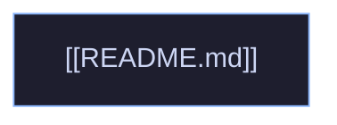

# Project Graph

> [!NOTE]
> Autogenerated dependency map for Obsidian and Antigravity Token Optimization.
> **Generated at**: 2026-11-18 07:22:45 | **Detected Stack**: Generic | **Total Files Indexed**: 1

## Architecture Graph (Mermaid.js)

## Node Index & Dependencies (Wikilinks)

### [[README.md]]
- **Dependencies (Imports)**: None
- **Referenced By (Dependents)**: Entrypoint or unreferenced
